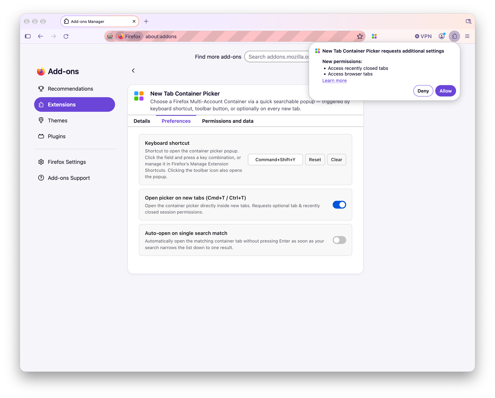

# New Tab Container Picker

A lightweight **Manifest V3** Firefox extension for opening new tabs in any Firefox Multi-Account Container via a fast, keyboard-searchable picker — on demand with a customizable keyboard shortcut or toolbar button, and optionally directly inside every new tab (`Cmd+T` / `Ctrl+T`).

## Why this exists?

Firefox already provides a way to always ask for a container while opening a new tab, but it works only on mouse click, the option in settings is literally called `privacy.userContext.newTabContainerOnLeftClick.enabled`

<p align="center"><i>Firefox settings for Container</i></p>


<p align="center"><i>Container picker view on mouse click (Default behaviour)</i></p>


This extension provides a way to use a shortcut of your own OR override the default cmd+T shortcut.

## Highlights

- Open picker on new tabs through the default shortcut (`Cmd+T` / `Ctrl+T`) OR through a shortcut of your own choice.

- Instant Keyboard Search & Navigation: Opens focused on the search bar with exact, prefix, substring, and fuzzy matching.

<p align="center"><i>Overrides Cmd+T/Ctrl+T to show container picker</i></p>


<p align="center"><i>Settings page (automatically open the container when there is only one match)</i></p>



<p align="center"><i>Don't override cmd+T, instead use the toolbar icon via custom keyboard shortcut</i></p>


## Prerequisites

- **Firefox 142+** with Container Tabs enabled (**Settings → General → Tabs → Enable Container Tabs**, or Firefox Multi-Account Containers).
- **Node.js** (for running via `web-ext`, tests, and linting).

## How to Run

### With `web-ext` (temporary Firefox profile)

```sh
npm install
npm start
```

### Manually in Firefox

1. Open `about:debugging#/runtime/this-firefox` in Firefox.
2. Click **Load Temporary Add-on…** and select `manifest.json`.

## Development

- `npm test` — Run unit and integration tests (`node --test`).
- `npm run lint` — Lint the extension with `web-ext`.
- `npm run build` — Build a packaged `.zip` into `web-ext-artifacts/`.
